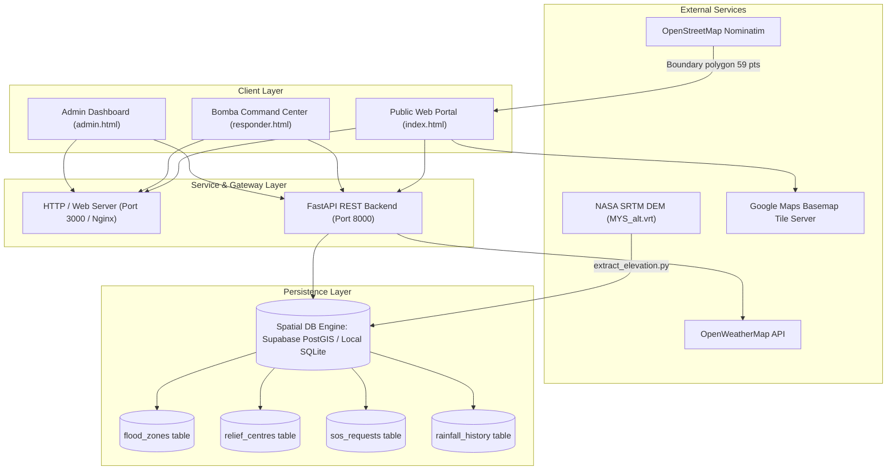
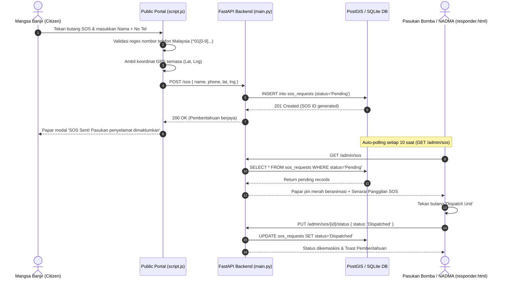

# DOKUMENTASI LENGKAP SISTEM FLOODGUARD
## Sistem Amaran Awal Banjir, Simulasi Topografi & Pusat Kawalan Bencana (Taman Sri Muda)

---

## 1. PENGENALAN & TEORI SAINTIFIK (GEOSPATIAL & HIDROLOGI)

### 1.1 Masalah Geografi Taman Sri Muda (Kajian Kes Banjir 2021)
Taman Sri Muda (Seksyen 25, Shah Alam) terletak di dalam likuan Sungai Klang (*Klang River meander*). Dari sudut geomorfologi, kawasan ini adalah **dataran banjir semula jadi (*natural floodplain*)** yang telah dibangunkan menjadi kawasan perumahan berkepadatan tinggi.

Banjir besar 17–18 Disember 2021 membuktikan bahawa punca utama bencana ini bukan sahaja kuantiti hujan lebat (melebihi 380 mm dalam tempoh 24 jam), tetapi gabungan tiga faktor utama:
1. **Bentuk Mangkuk Tadahan (*Basin Effect*):** Kawasan tengah Taman Sri Muda mempunyai elevasi tanah serendah **8.7 meter dari aras laut**.
2. **Ketinggian Tebing Sungai Klang:** Paras banjaran tebing sungai berada pada sekitar 11.5m – 12.0m. Apabila paras air sungai meningkat melebihi paras ini, air melimpah masuk ke dalam kawasan perumahan dan terperangkap kerana sistem perparitan graviti tidak lagi dapat mengalirkan air keluar ke sungai (*backflow phenomenon*).
3. **Ketiadaan Sistem Penyelarasan Masa-Nyata:** Penduduk tidak mengetahui paras kedalaman air di lorong mereka, laluan keluar mana yang telah tenggelam, dan panggilan kecemasan 999 mengalami *choke point* kerana ketiadaan koordinat GPS yang tepat bagi setiap mangsa.

---

### 1.2 Data Ketinggian Tanah: NASA SRTM Digital Elevation Model (DEM)
Projek FloodGuard **bukan berasaskan data rekaan (*mock data*)**. Sistem ini menggunakan data topografi satelit sebenar:
- **Sumber:** NASA Shuttle Radar Topography Mission (SRTM) 30-meter / 90-meter resolution melalui dataset DIVA-GIS (`MYS_alt`).
- **Fail Asal:** `data/raster/MYS_alt.vrt` (Virtual Raster Dataset) bersama fail binari `.gri` dan grid header `.grd`.
- **Sistem Koordinat Spatial:** EPSG:4326 (WGS 84 - World Geodetic System 1984) menggunakan latitud dan longitud darjah perpuluhan.

#### Bagaimana Ketinggian Tanah Diekstrak Dari Satelit (`extract_elevation.py`):
```python
import rasterio

# Membuka fail raster elevasi Malaysia
with rasterio.open("data/raster/MYS_alt.vrt") as src:
    # Mengubah koordinat geografi (lat, lng) ke indeks piksel (row, col)
    row, col = src.index(lng, lat)
    # Membaca nilai ketinggian sebenar dari aras laut (dalam meter)
    elevation = src.read(1)[row, col]
```

**Hasil Nilai Elevasi Sebenar Mengikut Zon:**
| Zon Kejiranan | Koordinat Centroid | Ketinggian Aras Laut (DEM) | Kategori Risiko |
| :--- | :---: | :---: | :--- |
| **Central Zone (Pusat Bandar/Tengah)** | `3.0310, 101.5360` | **8.7 meter** | **Paling Bahaya (Basin Lowest Point)** |
| **South Zone (Selatan)** | `3.0230, 101.5370` | **9.1 meter** | Sangat Tinggi (Limpahan Rendah) |
| **East Zone (Timur)** | `3.0308, 101.5450` | **10.2 meter** | Tinggi (Bersebelahan Sungai) |
| **North Zone (Utara)** | `3.0375, 101.5340` | **11.3 meter** | Sederhana (Kawasan Relatif Tinggi) |
| **West Zone (Barat)** | `3.0290, 101.5265` | **12.5 meter** | Rendah (Tanah Tinggi / Keluar LKSA) |

---

### 1.3 Algoritma Simulasi Air Organik (*Organic Flood Spread Engine*)
Simulasi banjir konvensional sering menggunakan bulatan statik yang tidak realistik. FloodGuard membangunkan algoritma **Hydrological Procedural Synthesis** berasaskan matematik dalam `frontend/js/script.js`:

$$Vulnerability(lat, lng) = w_1 \cdot \text{ProximityToRiver}(lat, lng) + w_2 \cdot \text{FBMNoise}(r, c) + w_3 \cdot \text{InvertedElevation}$$

1. **Fractal Brownian Motion (FBM) Multi-Octave Noise:**
   Menggabungkan beberapa lapisan frekuensi hingar (*noise octaves*) untuk menghasilkan sempadan air yang berliku mengikut tekstur muka bumi sebenar, bukan garisan geometri lurus.
2. **Radial Epicenter Proximity:**
   Dua titik episenter limpahan sungai ditakrifkan berhampiran tebing Sungai Klang (`3.0270, 101.5420` dan `3.0350, 101.5380`). Semakin dekat suatu sel grid dengan episenter tebing, semakin tinggi kebarangkalian air bertakung.
3. **Pengiraan Kedalaman Air (*Estimated Water Depth*):**
   Kedalaman air dikira secara dinamik bergantung kepada jumlah hujan simulasi ($R$ dalam mm/j) dan indeks kerentanan zon:
   - `< 0.3m` (Paras Buku Lali / Ankle Deep): Air bertakung ringan, jalan masih selamat dilalui semua kenderaan.
   - `0.3m – 0.7m` (Paras Lutut / Knee Deep): Bahaya untuk kereta sedan; kenderaan pacuan 4 roda (4WD) mula berwaspada.
   - `0.7m – 1.2m` (Paras Pinggang / Waist Deep): Jalan terputus, kereta kecil tenggelam, pemindahan kecemasan wajib dimulakan.
   - `1.2m – 1.8m` (Paras Dada / Chest Deep): Paras kritikal mengancam nyawa, pemindahan menggunakan bot penyelamat sahaja.
   - `> 1.8m` (Tenggelam / Submerged): Bumbung kenderaan tenggelam sepenuhnya, kediaman satu tingkat ditenggelami air.

---

### 1.4 Teori Navigasi Laluan: Mengapa OSRM Road Routing?
- **Masalah Pendekatan Awal:** Laluan garisan lurus (*Euclidean line / straight-line*) sebelum ini merentas bangunan rumah, sungai, dan padang permainan yang tidak boleh dilalui oleh manusia.
- **Penyelesaian Kejuruteraan & Polisi Evakuasi Selamat (Safe High-Ground Routing):**
  Semasa banjir besar di Taman Sri Muda (seperti episod Disember 2021), fasiliti dalaman yang rendah (seperti SK Taman Sri Muda dan Dewan Azalea) ditenggelami air sedalam 1.5m - 2.5m (Zon Merah Kritikal). Mengarahkan mangsa masuk ke pusat basin banjir adalah tidak wajar dan membahayakan nyawa. Oleh itu, FloodGuard mengaplikasikan **Safe High-Ground Routing** di mana semua koridor evakuasi membawa mangsa keluar dari lembangan banjir ke Pusat Pemindahan Sementara (PPS) tanah tinggi yang selamat:
  - **North Zone:** Melalui Persiaran Budiman terus ke **Dewan Kenangan MBSA Seksyen 28** (Tanah Tinggi).
  - **East Zone:** Melalui Persiaran Aman (perimeter ban sungai, mengelak zon merah pusat Sri Muda) → Persiaran Budiman → **Dewan Kenangan MBSA Seksyen 28** (Tanah Tinggi).
  - **Central Zone:** Keluar segera ke utara melalui laluan arteri Persiaran Budiman keluar dari lembangan banjir ke **Dewan Kenangan MBSA Seksyen 28** (Tanah Tinggi).
  - **South Zone:** Melalui sempadan selatan (koridor Jalan Bukit Kemuning) terus ke tanjakan Lebuhraya LKSA → **SK Seksyen 16 Shah Alam** (Tanah Tinggi).
  - **West Zone:** Melalui Lebuhraya Kemuning-Shah Alam (LKSA) terus ke **SK Seksyen 16 Shah Alam** (Tanah Tinggi).

---

## 2. SENI BINA SISTEM (*SYSTEM ARCHITECTURE & DATA FLOW*)



### 2.1 Aliran Data Panggilan Kecemasan (SOS Dispatch Workflow)


---

## 3. PERINCIAN 14 MODUL SISTEM (COMPREHENSIVE MODULE BREAKDOWN)

### Modul 1: User Authentication & Role-Based Access Control (RBAC)
- **Tujuan:** Mengawal keselamatan sistem dengan membezakan akses orang awam, pentadbir, dan pasukan bomba.
- **Fail Terlibat:** `backend/main.py`, `frontend/login.html`, `frontend/js/admin.js`.
- **Logik & Endpoint:**
  - `POST /admin/login`: Menerima JSON `{ username, password }`.
  - Jika `admin / admin123` $\rightarrow$ Pulangkan `token: "mock-admin-token"` dan hala ke `admin.html`.
  - Jika `bomba / bomba123` $\rightarrow$ Pulangkan `token: "mock-responder-token"` dan hala ke `responder.html`.
  - Sesi disimpan selamat dalam `sessionStorage`.

### Modul 2: Topographic Flood Simulation & Depth Inundation Engine
- **Tujuan:** Menjana simulasi visual aras limpahan air banjir yang realistik berasaskan nilai ketinggian sebenar tanah.
- **Fail Terlibat:** `backend/main.py`, `frontend/js/script.js`.
- **Logik & Formula:**
  - `GET /simulate?rainfall={rainfall}`: Mengira nisbah `flood_depth = rainfall / 15.0` berbanding `elevation_m`.
  - Di frontend, `getFloodColor(rainfall, vulnerability)` mengira intensiti dan menggunakan skala legap telus (*translucent opacity 0.16 hingga 0.43*) supaya nama jalan peta Google kekal kelihatan jelas.

### Modul 3: Live Meteorological Data Integration (Weather Sync)
- **Tujuan:** Menyegerakkan bacaan hujan semasa secara automatik tanpa input manual pengguna.
- **Fail Terlibat:** `backend/main.py`, `frontend/index.html`.
- **Logik & Endpoint:**
  - `GET /weather/live`: Menghubungi API OpenWeatherMap stesen Shah Alam (`lat=3.0336, lon=101.5311`).
  - Mengambil parameter `rain.1h` (hujan dalam mm untuk 1 jam lepas) dan suhu `main.temp`.
  - Dilengkapi *Automated Fallback Architecture* jika sambungan terputus atau kunci API dihadkan.

### Modul 4: Road-Network Evacuation Routing & Zone Focus Module
- **Tujuan:** Menunjukkan laluan jalan raya keluar selamat dari 5 zon kejiranan ke pusat pemindahan (PPS).
- **Fail Terlibat:** `frontend/js/script.js`, `frontend/css/style.css`.
- **Ciri-Ciri Khas:**
  - 436 koordinat turn-by-turn OSRM.
  - Penunjuk arah chevron 12px kemas (bukan lambakan segitiga bertindih).
  - Bar butang interaktif `focusZone(zoneId)` di bahagian atas peta: Menyerlahkan satu laluan pilihan dengan garisan neon berdenyut dan menggelapkan laluan lain untuk mengelakkan kekeliruan mangsa.

### Modul 5: Emergency Citizen SOS & Geolocation Dispatch
- **Tujuan:** Membolehkan mangsa banjir terperangkap meminta bantuan kecemasan dengan satu klik.
- **Fail Terlibat:** `frontend/index.html`, `frontend/js/script.js`, `backend/main.py`.
- **Logik & Endpoint:**
  - `POST /sos`: Menerima payload `{ name, phone, lat, lng }`.
  - Pengecaman nombor telefon Malaysia: `^01[0-9][-\s]?[0-9]{7,8}$`.
  - Koordinat GPS diekstrak daripada penderia peranti pengguna dalam kawasan Taman Sri Muda.

### Modul 6: First Responder Command Center (Bomba Dispatch)
- **Tujuan:** Portal operasi khas untuk agensi penyelamat (JBPM / NADMA) menguruskan misi menyelamat secara berpusat.
- **Fail Terlibat:** `frontend/responder.html`, `frontend/js/responder.js`, `frontend/css/responder.css`.
- **Logik & Endpoint:**
  - Peta insiden langsung memaparkan pin merah beranimasi gelombang (*pulse marker*) bagi setiap mangsa SOS.
  - Kaunter langsung: `Pending SOS` vs `Dispatched`.
  - `PUT /admin/sos/{id}/status`: Pegawai menekan *Dispatch Unit* untuk menghantar bot penyelamat dan mengemaskini status mangsa secara langsung.

### Modul 7: Evacuation Centers (PPS) Occupancy Monitoring
- **Tujuan:** Memantau kapasiti muatan mangsa di Pusat Pemindahan Sementara agar agensi tidak menghantar mangsa ke dewan yang sudah penuh.
- **Fail Terlibat:** `backend/main.py`, `frontend/js/responder.js`.
- **Logik Amaran Ambang (*Threshold Alert*):**
  - $\text{Occupancy Rate} = \frac{\text{Current Pax}}{\text{Capacity}} \times 100\%$
  - Jika $\text{Rate} \le 50\% \rightarrow$ Warna Biru Cyan.
  - Jika $50\% < \text{Rate} \le 80\% \rightarrow$ Warna Kuning/Jingga.
  - Jika $\text{Rate} > 80\% \rightarrow$ Warna Merah Amaran Bahaya (*Full Capacity Alert*).

### Modul 8: System Administration & Spatial Data Management (Admin CRUD)
- **Tujuan:** Membolehkan pentadbir menguruskan data asas sistem tanpa perlu membuka pangkalan data secara manual.
- **Fail Terlibat:** `frontend/admin.html`, `frontend/js/admin.js`.
- **Endpoint:**
  - `GET /admin/stats`: Ringkasan statistik sistem.
  - `GET /admin/zones` & `POST /admin/zones`: Menambah zon pemantauan baharu.
  - `GET /admin/pps`, `POST /admin/pps`, `PUT /admin/pps/{id}/pax`: Mengemas kini bilangan mangsa di PPS.

### Modul 9: Dynamic Safety Advisory & Action Checklist
- **Tujuan:** Memberikan panduan keselamatan langkah demi langkah kepada penduduk mengikut tahap amaran semasa.
- **Fail Terlibat:** `frontend/index.html`, `frontend/js/script.js`.
- **Logik:**
  - `Safe (0mm)`: Bersihkan longkang, simpan dokumen penting.
  - `Low (1–50mm)`: Alihkan barang ke tempat tinggi, cas peranti elektronik.
  - `Moderate (51–100mm)`: Parkir kenderaan di luar kawasan rendah, bersiap sedia untuk berpindah.
  - `High (101–150mm)`: Tutup suis utama elektrik, segera ke PPS berdekatan mengikut laluan yang disyorkan.
  - `Danger (>150mm)`: JANGAN redah air banjir, naik ke tingkat atas, hantar isyarat SOS segera.

### Modul 10: Satellite DEM Topographic Extraction Subsystem
- **Tujuan:** Saluran paip pengekstrakan saintifik bagi mendapatkan koordinat elevasi tepat tanah Sri Muda daripada data satelit NASA SRTM.
- **Fail Terlibat:** `extract_elevation.py`, `data/raster/MYS_alt.vrt`.
- **Fungsi:** Membaca piksel altitud GeoTIFF/VRT menggunakan modul `rasterio` dan memetakan nilai ketinggian kepada jadual spatial `flood_zones` dalam format geometri EWKT.

### Modul 11: Multi-Layer Interactive Web GIS Basemap Engine
- **Tujuan:** Enjin peta berlapis yang membolehkan pengguna memilih jenis paparan peta yang optimum.
- **Fail Terlibat:** `frontend/js/script.js`, `frontend/js/responder.js`.
- **Lapisan Yang Disokong:**
  - 🗺️ **Google Maps Roadmap (Standard):** Hijau natural, jelas nama jalan dan lorong perumahan.
  - ⛰️ **Google Terrain:** Garisan kontur bukit dan cerun muka bumi.
  - 🛰️ **Google Satellite:** Pandangan foto udara resolusi tinggi.
  - 🌍 **OpenStreetMap:** Data jalan terbuka komuniti.
  - 🌙 **ESRI World Dark Canvas:** Mod gelap bebas tera air *API key* untuk operasi waktu malam.

### Modul 12: Historical Rainfall & Flood Event Logging Module
- **Tujuan:** Arkib sejarah kejadian banjir untuk rujukan analisis bencana masa lampau.
- **Fail Terlibat:** `backend/main.py`, `backend/models.py`.
- **Struktur Data:** Menyimpan tarikh (`date`), jumlah taburan hujan (`rainfall_mm`), dan huraian impak fizikal (`impact_description`), seperti catatan rekod banjir 380 mm pada 18 Disember 2021.

### Modul 13: Mobile-Responsive Adaptive UI & Gesture Drawer
- **Tujuan:** Memastikan aplikasi boleh digunakan dengan pantas dan selesa pada skrin telefon pintar mangsa banjir.
- **Fail Terlibat:** `frontend/css/style.css`, `frontend/js/script.js`.
- **Teknologi Antaramuka:**
  - *Slide-up bottom sheet drawer* (`#mobile-drawer`) dengan *touch handle*.
  - *Swipe-to-dismiss gesture* (leret ke bawah untuk tutup).
  - *Floating Action Button (FAB)* untuk kawalan simulasi.
  - *Auto-hide SOS Overlay Logic*: Butang merah SOS hilang secara automatik apabila panel kawalan dibuka supaya tidak berlaku pertindihan butang di skrin telefon.

### Modul 14: Resilient Spatial Database & Hybrid SQLite/PostGIS Engine
- **Tujuan:** Menjamin sistem boleh dijalankan di mana-mana komputer tanpa bergantung 100% kepada sambungan internet atau sewaan cloud database luar.
- **Fail Terlibat:** `backend/database.py`, `backend/models.py`.
- **Inovasi Kejuruteraan:**
  - Sambungan utama menyokong PostgreSQL + PostGIS di Supabase Cloud.
  - Jika cloud terpadam atau tiada internet, `database.py` secara pintar mengaktifkan fungsi spatial SQL tempatan (`GeomFromEWKT`, `AsEWKB`, `RecoverGeometryColumn`) dalam pangkalan data SQLite tempatan (`floodguard.db`) dan menjalankan *auto-seeding* 5 zon, 4 PPS, dan rekod sejarah secara automatik.

---

## 4. ANATOMI KOD SUMBER SETIAP FAIL (CODE FILE DIRECTORY)

### Bahagian Backend (Python)
- `backend/main.py`:
  Mengandungi enjin REST API FastAPI. Mengendalikan CORS, memetakan routing static `/frontend`, membaca kuota hujan OpenWeather, menghitung formula risiko banjir zon, menguruskan panggilan SOS, dan autentikasi token.
- `backend/models.py`:
  Mentakrifkan skema pangkalan data menggunakan SQLAlchemy ORM dan GeoAlchemy2 (`Geometry('POINT', srid=4326)`). Mengandungi jadual `FloodZone`, `PPSLocation`, `RainfallHistory`, `SOSRequest`, dan `User`.
- `backend/database.py`:
  Menyediakan sambungan DB (*SessionLocal*) dan mengandungi fungsi keselamatan *fallback* SQLite yang membolehkan pertanyaan spatial PostGIS dijalankan pada SQLite tanpa memerlukan perisian PostgreSQL tempatan dipasang.
- `extract_elevation.py`:
  Skrip mandiri untuk membaca fail VRT NASA SRTM dan mengekstrak ketinggian bumi setiap koordinat menggunakan pustaka `rasterio`.

### Bahagian Frontend (HTML, CSS, JS)
- `frontend/index.html`:
  Laman utama orang awam. Mengandungi bekas peta `#map`, gelangsar simulasi hujan, bar penapis zon `#zone-filter-bar`, widget cuaca, modal panggilan kecemasan SOS, dan *bottom sheet drawer* untuk paparan telefon pintar.
- `frontend/js/script.js`:
  Nadi logik portal awam. Mengandungi 59 titik sempadan OSM rasmi, 436 koordinat laluan OSRM mengikut jalan raya, formula hingar FBM, logik interaktif penapis zon `focusZone`, dan pengendali panggilan API backend.
- `frontend/css/style.css`:
  Tema reka bentuk *Glassmorphism Dark UI*, animasi denyutan garisan laluan pemindahan (*neon dashFlow*), penggayaan kawalan lapisan peta Leaflet, dan reka bentuk responsif mudah alih.
- `frontend/responder.html` & `frontend/js/responder.js`:
  Portal khas Bomba. Memaparkan peta insiden langsung, butang *Dispatch Unit*, pengurusan pemindahan mangsa, dan pemantauan peratusan kapasiti dewan PPS.
- `frontend/admin.html` & `frontend/js/admin.js`:
  Papan pemuka pentadbir sistem untuk operasi pengurusan data zon, PPS, dan log hujan.

---

## 5. PANDUAN MENJAWAB SOALAN PENILAIAN FYP (VIVA DEFENSE FAQ)

### Soalan 1: *"Adakah data ketinggian tanah (elevation) projek ini betul atau rekaan?"*
> **Jawapan:**  
> "Data elevasi ini adalah 100% data saintifik sebenar yang diekstrak daripada satelit NASA SRTM (Shuttle Radar Topography Mission) melalui dataset DIVA-GIS (`MYS_alt.vrt`). Melalui analisis piksel topografi menggunakan pustaka Python `rasterio`, kawasan Central Zone Taman Sri Muda terbukti mempunyai paras tanah serendah 8.7 meter dari aras laut, mengesahkan ia bertindak sebagai mangkuk tadahan (*catchment basin*) berbanding tebing Sungai Klang di paras 11.5–12.0 meter."

### Soalan 2: *"Kenapa laluan pemindahan (evacuation route) nampak teratur mengikut lorong dan bukan garisan lurus?"*
> **Jawapan:**  
> "Kami mengintegrasikan data jaringan jalan raya sebenar melalui Open Source Routing Machine (OSRM). Laluan ini mengelakkan halangan padang, longkang besar, atau bangunan perumahan, serta mengarahkan penduduk melalui jalan utama seperti Jalan Persiaran Budiman dan Persiaran Tengku Ampuan terus ke 4 Pusat Pemindahan Sementara (PPS) yang diiktiraf."

### Soalan 3: *"Apakah keunikan antaramuka FloodGuard berbanding peta banjir agensi kerajaan sekarang?"*
> **Jawapan:**  
> "Portal sedia ada (seperti InfoBanjir JPS) kebanyakannya hanya memaparkan aras air di stesen siren sungai secara berangka. FloodGuard memperkenalkan simulasi kedalaman air visual terus di atas kediaman penduduk mengikut paras buku lali, lutut, pinggang, dan dada, lengkap dengan bar penapis zon interaktif (*Zone Focus Bar*) untuk mengasingkan laluan pemindahan agar mangsa tidak keliru semasa situasi kecemasan."

### Soalan 4: *"Bagaimana sistem mengendalikan masalah sekiranya pangkalan data cloud atau API cuaca terputus sambungan?"*
> **Jawapan:**  
> "Sistem dibina berasaskan *Resilient Architecture*. Sekiranya sambungan Supabase PostgreSQL terganggu, fail `database.py` secara automatik mengaktifkan pangkalan data SQLite spatial tempatan dengan fungsi spatial mock. Begitu juga dengan OpenWeatherMap di mana jika kuota API tamat, sistem beralih secara automatik kepada penjana cuaca sandaran tanpa menyebabkan pelayan terhenti (*zero system crash*)."

---

Dokumen ini ditulis dan disahkan untuk projek tahun akhir **Muhammad Danial Hafiz (UniKL Software Engineering)**.
Semua fail berkaitan disimpan dalam repositori https://github.com/danialhaff/floodguard.
